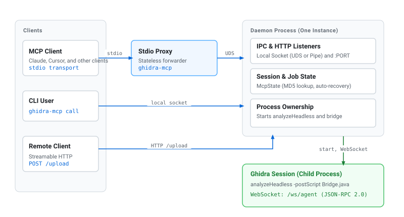
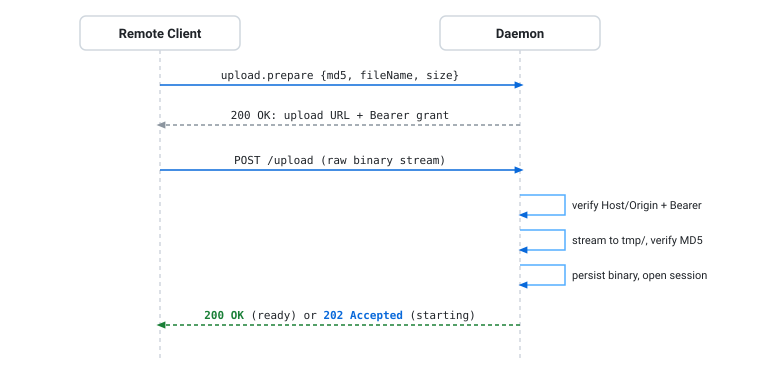
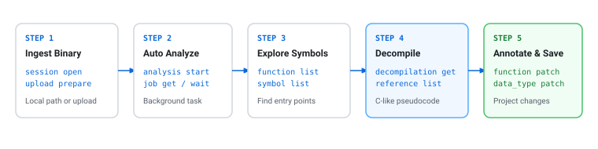
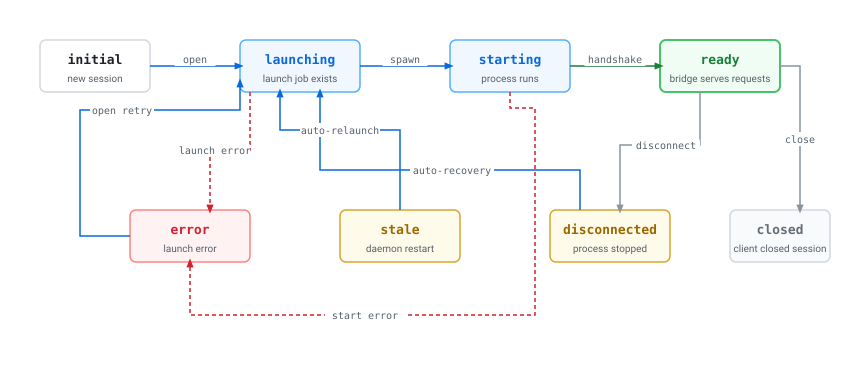

# ghidra-mcp

[English](README.md) | [中文](README.zh-CN.md) | [日本語](README.ja-JP.md)


`ghidra-mcp` は、Ghidra のヘッドレス解析のための MCP サーバーおよびコマンドラインツールです。

1 つのローカルデーモンが、Linux、macOS、Windows 上で Ghidra セッションを実行します。
MCP クライアントは stdio または HTTP でデーモンに接続します。
コマンドラインツールも同じデーモンを使用します。
バイナリの MD5 が、すべてのクライアントに共通してそのセッションを識別します。

> [!IMPORTANT]
> デーモンは、設定、バイナリ、解析結果を**永続ホーム**に保存します。
> 永続ホームのデフォルトは、Linux と macOS では `~/.ghidra-mcp`、Windows では `%LOCALAPPDATA%\ghidra-mcp` です。
> 別のディレクトリを使用するには、`GHIDRA_MCP_HOME` を設定します。
> デーモンは一時ファイルを非公開の**ランタイムディレクトリ**に保存します。
> デーモンが実行されていない場合、stdio クライアントとコマンドラインツールがデーモンを起動します。



## 目次

- [機能](#機能)
- [はじめに](#はじめに)
- [使用方法](#使用方法)
- [コーディングエージェントでの使用](#コーディングエージェントでの使用)
- [設定](#設定)
- [MCP ツール](#mcp-ツール)
- [ファイルとディレクトリ](#ファイルとディレクトリ)
- [検証とリリース](#検証とリリース)
- [トラブルシューティング](#トラブルシューティング)
- [ドキュメント](#ドキュメント)
- [コントリビューション](#コントリビューション)
- [ライセンス](#ライセンス)

## 機能

- **stdio、Streamable HTTP、または旧式 SSE による MCP。** 1 つのデーモンが共有状態を保持します。
- **コマンドラインクライアント。** ツールをローカルで一覧表示し、デーモン経由でツールを呼び出します。
- **MD5 によるセッション識別。** デーモンはセッションを再利用するか、保存済みの解析を再度開きます。
- **永続的なセッションとジョブ。** クライアントが切断した後も、セッションと解析ジョブは継続します。
- **リモートアップロード。** デーモンホスト上にないクライアントは、別の HTTP エンドポイントでバイナリを送信します。
- **Ghidra への完全なアクセス。** Java ブリッジが、プログラムデータ、関数、逆コンパイル、シンボル、参照、メモリ、コメントを提供します。
- **単一の実行ファイル。** 実行ファイルには、ブリッジ JAR とその起動スクリプトが含まれます。
- **バックグラウンドジョブ。** `ghidra_job get` と `ghidra_job wait` で長時間の解析を監視します。

デフォルトでは、セッションはプログラムを変更できます。
コーディングエージェントは、プログラムを変更する操作を使用する前に、ユーザーの承認を得る必要があります。

## はじめに

クライアント設定例と初回解析手順については、[最初の手順](docs/ja/getting-started.md) を参照してください。

### 前提条件

- Linux、macOS、または Windows。
- Java 21。
- `analyzeHeadless`（Windows では `analyzeHeadless.bat`）を含むローカルの Ghidra インストール。

### ビルド済み実行ファイルの使用

1. [GitHub Releases](https://github.com/ByteLandTechnology/ghidra-mcp/releases) から、お使いのプラットフォーム用のファイルをダウンロードします。

   | プラットフォーム | x86_64 | ARM64 |
   | --- | --- | --- |
   | macOS | `ghidra-mcp-macos-x86_64` | `ghidra-mcp-macos-arm64` |
   | Linux | `ghidra-mcp-linux-x86_64` | `ghidra-mcp-linux-arm64` |
   | Windows | `ghidra-mcp-windows-x86_64.exe` | `ghidra-mcp-windows-arm64.exe` |

2. ファイル名を `ghidra-mcp`（Windows では `ghidra-mcp.exe`）に変更します。
3. Linux と macOS では、`chmod +x ghidra-mcp` でファイルを実行可能にします。
4. 実行ファイルが Ghidra を見つけられることを確認します（[Ghidra の検索](#ghidra-の検索)を参照）。Windows での例：

   ```powershell
   $env:GHIDRA_INSTALL_DIR = 'C:\Tools\ghidra_12.1.4_PUBLIC'
   .\ghidra-mcp.exe tools
   ```

5. 実行ファイルを MCP クライアントに追加します：

   ```json
   {
     "command": "C:\\Tools\\ghidra-mcp.exe",
     "args": []
   }
   ```

実行ファイルに必要なのは Ghidra と Java だけです。
実行ファイルは、セッションを開くときにブリッジファイルをランタイムディレクトリに書き出します。

### ソースからのビルド

ソースからビルドするには、さらに次のものが必要です：

- Rust ツールチェーン。
- `bridge/` サブモジュール。ビルドはこのサブモジュールの Gradle wrapper を使用します。
- `GHIDRA_INSTALL_DIR` または `GHIDRA_HOME` にある Ghidra インストール。ブリッジはこのインストールに対してコンパイルされます。

1. サブモジュールなしでリポジトリをクローンした場合は、ブリッジを取得します：

   ```sh
   git submodule update --init --recursive
   ```

2. リリース用の実行ファイルをビルドします：

   ```sh
   cargo xtask build --release --locked --bin ghidra-mcp
   ```

結果は `target/release/ghidra-mcp`（Windows では `ghidra-mcp.exe`）です。
この 1 つのファイルが完全な配布物です。

`cargo xtask build` コマンドは、Gradle でブリッジをビルドします。
次に、ブリッジ JAR と `Bridge.java` を実行ファイルに埋め込みます。
操作カタログは、コンパイル時にブリッジ契約 `bridge/docs/asyncapi.yaml` から取得されます。

事前にビルドしたブリッジ JAR を埋め込むには、`GHIDRA_MCP_BRIDGE_JAR` を設定します。
相対パスはワークスペースのルートから始まります。
この場合、ビルドは `Bridge.java` だけを生成し、ブリッジをコンパイルしません。

### Ghidra の検索

デーモンは MCP サービスの開始前に、実行可能な `analyzeHeadless` が見つかるか確認します。
確認に失敗すると、エラーを stderr と `daemon.log` に書き込み、終了コード `1` で終了します。

デーモンは次の順序で `analyzeHeadless` を探します：

1. `config.toml` の `[ghidra].analyze_headless`。
2. `[ghidra].home`、`GHIDRA_INSTALL_DIR`、または `GHIDRA_HOME` にあるインストール。
3. `PATH` 上の `analyzeHeadless`。
4. `PATH` 上の `ghidraRun` が属するインストール。
5. Unix では、Homebrew の Cellar、および `/Applications`、`~`、`~/Applications`、`~/opt` にある `ghidra*` という名前のディレクトリ。

> [!TIP]
> 1 台のコンピューターに複数の Ghidra インストールがある場合は、`GHIDRA_INSTALL_DIR` を設定します。

## 使用方法

デフォルト設定では環境変数は必要ありません。
次の任意の変数でデフォルトを変更できます：

| 変数 | 用途 |
| --- | --- |
| `GHIDRA_INSTALL_DIR` | Ghidra のインストールディレクトリ。 |
| `GHIDRA_HOME` | インストールディレクトリの別名。`GHIDRA_INSTALL_DIR` が優先されます。 |
| `GHIDRA_MCP_HOME` | 永続ホーム。 |

Ghidra は、標準の Java 変数 `JAVA_HOME` と `JAVA_TOOL_OPTIONS` も使用します。
Unix では、`XDG_RUNTIME_DIR` と `TMPDIR` がランタイムディレクトリの場所を決めます。

### Stdio サーバー

MCP クライアントは `ghidra-mcp` を引数なしで起動し、stdio で通信します：

```json
{
  "command": "/path/to/ghidra-mcp",
  "args": []
}
```

このプロセスは、各ツール呼び出しをデーモンに送ります。
デーモンが実行されていない場合、このプロセスがデーモンを起動します。
このプロセスは、ローカルソケットでデーモンに接続します。
Unix では、ソケットは非公開の Unix ドメインソケットです。
Windows では、ソケットは名前付きパイプです。
このプロセスはツール呼び出し間でこの接続を再利用し、重複するハンドシェイク遅延を回避します。
デーモンが停止した場合、このプロセスは次の呼び出し時に再接続します。

ソースのチェックアウトから実行するには、コマンドとして `cargo run --` を使用します。

### HTTP サーバー

デーモンをフォアグラウンドで実行するには、次のコマンドを使用します：

```sh
ghidra-mcp --daemon
```

デーモンは、1 つのリスナー上で次のエンドポイントを提供します：

| エンドポイント | 用途 |
| --- | --- |
| `http://127.0.0.1:18489/mcp` | Streamable HTTP または旧式 SSE による MCP。 |
| `/upload` | バイナリのアップロード。 |
| `/ws/agent` | Ghidra ブリッジの WebSocket。 |

デーモンはループバックアドレスだけを受け付けます。
別のアドレスを使用するには、`--listen` を使用します：

```sh
ghidra-mcp --daemon --listen 127.0.0.1:18490
```

`--listen 127.0.0.1:0` を使用すると、システムが空いているポートを選択します。
デーモンは、そのアドレスをランタイムディレクトリの `server.json` と `daemon.log` に書き込みます。

すべてのクライアントが切断した後も、デーモンは実行を続けます。
フォアグラウンドのデーモンを停止するには、Ctrl-C を押します。
Unix では、`SIGINT`、`SIGTERM`、`SIGHUP` でも停止します。
デーモンは停止するときに、その Ghidra セッションを閉じます。
保存済みのプロジェクトは、後で再度開くことができます。

### コマンドラインツール

コマンドラインツールは、MCP と同じツールカタログを使用します。

デーモンを起動せずにツールを一覧表示するには、次のコマンドを使用します：

```sh
ghidra-mcp tools
```

デーモン経由でツールを呼び出すには、次のコマンドを使用します：

```sh
ghidra-mcp call ghidra_session '{"operation":"list"}'
```

`call TOOL [JSON]` は 1 つの JSON オブジェクトを受け付けます。デフォルトは `{}` です。
必要に応じて、このコマンドはデーモンを起動します。
このコマンドは、`structuredContent` を整形済み JSON として出力します。

| 結果 | 出力 | 終了コード |
| --- | --- | --- |
| 呼び出しが成功した。 | 結果を stdout に出力。 | 0 |
| 呼び出しが失敗した。 | エラーを stderr に出力。 | 1 |
| 引数が無効。 | 使用方法を stderr に出力。 | 2 |
| `--help` または `--version`。 | テキストを stdout に出力。 | 0 |

### リモートクライアントからのバイナリのアップロード

クライアントがデーモンホスト上にない場合は、この手順を使用します。



1. クライアント上で、ファイルの MD5 とバイト単位のサイズを計算します。
2. `ghidra_upload` ツールを呼び出します：

   ```json
   {"operation":"prepare","md5":"0123456789abcdef0123456789abcdef","params":{"fileName":"program.bin","size":1024}}
   ```

   `fileName` は表示名です。ディレクトリを含めてはいけません。
3. 結果を読み取ります。結果には次のフィールドがあります：
   - `method`：`POST`。
   - `url`：HTTP 呼び出しでは `https://host/ghidra/upload` などの絶対 URL。
     その他の転送方式では、MCP URL に対する相対 URL `upload`。
   - `headers`：1 回だけ使用できる `Authorization: Bearer` 資格情報と、`Content-Type: application/octet-stream`。
   - `expiresAt`：Unix 秒で表した有効期限。
4. 結果のヘッダーを使用して、ファイルを生のリクエスト本文として送信します：

   ```sh
   curl -X POST 'https://host/ghidra/upload' \
     -H 'Authorization: Bearer <credential>' \
     -H 'Content-Type: application/octet-stream' \
     --data-binary @program.bin
   ```

5. 応答を読み取ります：
   - HTTP `200`：セッションの準備ができています。
   - HTTP `202`：セッションは起動中です。返された `jobId` で `ghidra_job wait` を使用します。

別途 `ghidra_session open` を呼び出す必要はありません。

> [!NOTE]
> - アップロードは直接ディスクに書き込まれます。MCP リクエストのサイズ上限を超えることができます。デーモンは HTTP チャンク転送を受け付けます。
> - `ghidra_upload prepare` から 10 分以内にアップロードを開始する必要があります。この上限は、アクティブなアップロードには適用されません。
> - リクエストは開始時に資格情報を使用します。アップロードが失敗した後は、新しい資格情報を取得します。
> - デーモンは、バイナリを保存する前にサイズと MD5 を確認します。失敗したアップロードは、ファイルもセッションも残しません。
> - Ghidra が起動しなかった場合でも、バイナリは保存されたままです。MD5 を指定して `ghidra_session open` を再実行します。
> - リバースプロキシは、`/mcp` と `/upload` の両方を同じプレフィックスでデーモンに転送する必要があります。

サーバーは `Forwarded` のホストとプロトコルを優先し、次に `X-Forwarded-Host` と
`X-Forwarded-Proto` を使います。`X-Forwarded-Prefix` はプロキシが除去したパスを補います。
パスが `/mcp` で終わる HTTP または HTTPS の絶対 `Referer` URL も使用できます。
クライアントページを指す Referer はサーバーアドレスとして使用しません。
これらのヘッダーがなければ HTTP リクエストのアドレスを使います。
プロトコルまたはパスプレフィックスが無効な場合は相対 URL を返します。
プロキシは、クライアントが指定したアドレスヘッダーを正しい公開アドレスで置き換える必要があります。

## コーディングエージェントでの使用

コーディングエージェントは、`ghidra-mcp` を stdio サーバーとして起動するか、HTTP の URL に接続します。
同じランタイムディレクトリを使用するエージェントは、1 つのデーモンを共有します。



Claude Code では、実行ファイルをローカルの stdio サーバーとして追加します：

```sh
claude mcp add --transport stdio --scope local ghidra-mcp -- /absolute/path/to/ghidra-mcp
```

接続を確認するには、`claude mcp get ghidra-mcp` または `/mcp` パネルを使用します。
ステータスは `Status: ✓ Connected` である必要があります。

エージェントでは次の手順を使用します：

1. バイナリを開きます：
   - デーモンが以前に保存したバイナリには、`{"operation":"open","md5":"..."}` で `ghidra_session` を呼び出します。
   - デーモンホスト上のファイルには、`{"operation":"open","params":{"path":"..."}}` で `ghidra_session` を呼び出します。デーモンが MD5 を計算し、バイナリを保存します。
   - リモートクライアント上のファイルは、アップロードします（[リモートクライアントからのバイナリのアップロード](#リモートクライアントからのバイナリのアップロード)を参照）。
2. セッションが起動中の場合は、`{"operation":"wait","params":{"jobId":"...","timeoutMs":...}}` で `ghidra_job` を呼び出して待ちます。
   `ghidra_job get` でジョブを監視できます。
3. `ghidra_session get` で準備完了状態を確認します。
4. 解析を開始します：`{"operation":"start","md5":"..."}` で `ghidra_analysis` を呼び出します。
5. `ghidra_job get` または `ghidra_job wait` で解析ジョブを監視します。
6. `ghidra_program get`、`ghidra_function list`、`ghidra_data_type create` などのブリッジのドメインツールを使用します。
7. `ghidra_program save` で解析結果と変更を保存します。セッションは開いたままです。
8. プログラムを変更する操作を使用する前に、ユーザーの承認を得ます。

セッションの要約には、`md5`、`fileName`、`status`、`connected` だけが含まれます。
1 つのセッションを指定する操作は `md5` を使用します。別のセッション ID はありません。
`ghidra_session list` は任意です。
デーモンが知らない MD5 に対しては、デーモンはバイナリをアップロードするように伝えます。

## 設定

初回起動時に、デーモンは永続ホームにデフォルトの `config.toml` を書き込みます。
次の例は、すべてのキーとそのデフォルト値を示します：

```toml
[ghidra]
home = ""
analyze_headless = ""

[analysis]
max_cpu = 4

[timeouts]
process_spawn_timeout_sec = 30
analysis_import_timeout_sec = 1800
bridge_connect_timeout_sec = 30
agent_ready_timeout_sec = 30
bridge_disconnect_grace_sec = 5
graceful_kill_timeout_sec = 10
force_kill_timeout_sec = 5
rpc_ms = 30000
daemon_start_timeout_sec = 8
ipc_handshake_timeout_sec = 5
```

| キー | 用途 |
| --- | --- |
| `ghidra.home` | Ghidra のインストールディレクトリ。 |
| `ghidra.analyze_headless` | `analyzeHeadless` のパス。 |
| `analysis.max_cpu` | `analyzeHeadless -max-cpu` の値。 |
| `timeouts.process_spawn_timeout_sec` | Ghidra プロセスを起動する時間。 |
| `timeouts.analysis_import_timeout_sec` | バイナリをインポートする時間。`ghidra_analysis start` のデフォルトの待機時間でもあります。 |
| `timeouts.bridge_connect_timeout_sec` | セッションを起動する合計時間の一部。 |
| `timeouts.agent_ready_timeout_sec` | ブリッジがハンドシェイクを完了する時間。 |
| `timeouts.bridge_disconnect_grace_sec` | ブリッジの切断またはセッションのクローズの後に、プロセスが自分で停止する時間。 |
| `timeouts.graceful_kill_timeout_sec` | デーモンが停止を指示した後に、プロセスが停止する時間。 |
| `timeouts.force_kill_timeout_sec` | デーモンが強制終了した後に、プロセスが停止する時間。 |
| `timeouts.rpc_ms` | 1 つのブリッジリクエストの時間（ミリ秒）。 |
| `timeouts.daemon_start_timeout_sec` | プロキシまたは CLI モードでデーモンを待つ時間。 |
| `timeouts.ipc_handshake_timeout_sec` | プロキシとデーモン間の IPC ハンドシェイクのタイムアウト時間。 |

- `home` または `analyze_headless` が空文字列の場合は、値がない場合と同じです。
- デーモンは、その他のセクションとキーを無視します。ファイルは有効な TOML である必要があります。
- Java の一時ファイルは、常にランタイムディレクトリの `tmp/` ディレクトリに置かれます。
- デーモンは、削除されたキー `ghidra.java_tmp_dir`、`ghidra.script_path`、`ghidra.bridge_script` を受け付けません。ファイルから削除してください。

## MCP ツール

`tools/list` は 18 個の MCP ツールを表示します：`ghidra_help` と、ドメインごとに 1 つのツールです。
ブリッジのドメインツールは、ブリッジ MCP サーバーのドメイン名と操作名を使用します。
デーモンにはローカル操作もありますが、ブリッジの shutdown 操作は公開しません。
このドキュメントでは、操作をツール名と操作名で表します（例：`ghidra_session open`）。

ドメインツールには次の引数があります：

- `operation`：必須。ドメイン内の操作です（例：`list`）。
- `md5`：セッションを識別するバイナリの MD5 です。32 桁の 16 進文字で、`params` には入れません。名前ではなく、ファイルの実際のダイジェストか既存セッションの MD5 を使用します。各操作には md5 ルール（`required`、`optional`、`absent`）があります。
- `params`：操作のパラメータです。デフォルトは `{}` です。

| ツール | 操作 | 実行場所 |
| --- | --- | --- |
| `ghidra_session` | `open`、`list`、`get`、`close` | デーモン。 |
| `ghidra_upload` | `prepare` | デーモン。 |
| `ghidra_job` | `get`、`wait` | デーモン。 |
| `ghidra_analysis` | `start`、`get` | `start`：デーモン、次にブリッジ。`get`：ブリッジ。 |
| `ghidra_bridge`、`ghidra_program`、`ghidra_address`、`ghidra_memory`、`ghidra_listing`、`ghidra_global_variable`、`ghidra_function`、`ghidra_decompilation`、`ghidra_symbol`、`ghidra_reference`、`ghidra_comment`、`ghidra_data_type`、`ghidra_batch` | そのドメインのブリッジメソッド。 | セッションのブリッジ。 |

ブリッジ契約 `bridge/docs/asyncapi.yaml` が、ブリッジメソッド、そのスキーマ、`read_only` 効果を定義します。
デーモンは契約にあるメソッドだけを送ります。
`interface.get` と `session.shutdown` は提供しません。セッションを停止するには、`ghidra_session close` を使用します。
パラメータには、`selector`、`filter`、`page`、`patch`、`resource` などのブリッジのオブジェクトを使用します。

`ghidra_function get` と `ghidra_comment upsert` の例：

```json
{"operation":"get","md5":"0123456789abcdef0123456789abcdef","params":{"selector":{"entry":"ram:00100000"}}}
{"operation":"upsert","md5":"0123456789abcdef0123456789abcdef","params":{"resource":{"address":"ram:00100000","type":"eol","text":"checked"}}}
```

操作を初めて呼び出す前に、ドメインと操作名を指定して `ghidra_help` を呼び出します。
返される `inputSchema` は、ツールのトップレベル引数ではなく `params` の内容を説明します。
呼び出す前に必須フィールドとその入れ子構造を確認します。

`ghidra_help` ツールは、すべてのツールを説明します：

- `{}` は、ドメインツールを一覧表示します。
- `{"domain":"function"}` は、1 つのドメインの操作を一覧表示します。
- `{"domain":"function","operation":"list"}` は、1 つの操作の完全なパラメータスキーマ、md5 ルール、効果を表示します。効果はブリッジ契約と同じです（例：`read_only`、`mutates_program`、`destructive`）。

Ghidra プロセスが起動しなかった場合、セッションは `error` に、その起動ジョブは `failed` になります。
`wait=false` の場合、`ghidra_session open` はすぐに戻ります。結果は `ghidra_session get` と `ghidra_job get` で確認します。
`wait=true` の場合、`ghidra_session open` は待機してエラーを返します。

バイナリの MD5 が各セッションを識別します。
デーモンは有限状態機械を通じてセッション状態を管理します：



ツール呼び出しが失敗した場合、`structuredContent` には機械可読な JSON-RPC エラーコードが含まれます：
- `-32602`（`invalid_argument`）：未知のツール、または無効か存在しないツール引数や操作パラメータ。
- `-32001`（`session_lock_timeout`、`agent_timeout`、`request_in_flight`）：ロックタイムアウトまたはリクエスト衝突。
- `-32002`（`missing_target`）：未知のバイナリ MD5、セッション、ジョブ ID、ドメイン、または操作。
- `-32000`（`disconnected`、`shutting_down`）：切断されたブリッジセッションまたはデーモンのシャットダウン。
- `-32603`（`transaction_failed`、`bridge_internal`、`internal_error`）：Ghidra トランザクション失敗または内部エラー。
データベーストランザクションの失敗はコード `-32603`（`transaction_failed`）を返します。
無効な引数として返すことはありません。

## ファイルとディレクトリ

Unix では、永続データとランタイムデータは別の場所にあります：

```text
GHIDRA_MCP_HOME/                 # デフォルト：~/.ghidra-mcp
|-- config.toml
`-- projects/<md5>/
    |-- binary                  # 保存済みのバイナリ（固定の名前）
    |-- binary.json             # 元のファイル名
    `-- ghidra/
        |-- project.gpr
        `-- project.rep/

<runtime-base>/ghidra-mcp-<uid>/
|-- projects -> GHIDRA_MCP_HOME/projects
|-- sessions/<md5>/session.json
|-- logs/<md5>/
|-- tmp/
|-- daemon.sock
|-- daemon.log
|-- daemon.lock
|-- server.json
|-- ghidra-bridge.jar
`-- Bridge.java
```

- ランタイムのベースディレクトリは、Linux では `XDG_RUNTIME_DIR` です。それ以外では、システムの一時ディレクトリです。
- ランタイムのベースディレクトリに隠しセグメントがある場合、デーモンは代わりに `/tmp` を使用します。Ghidra は隠しセグメントを受け付けません。
- ランタイムディレクトリのモードは `0700` です。デーモンのログとロックファイルのモードは `0600` です。
- Ghidra は、隠しディレクトリにあるプロジェクトを開けません。そのため、デーモンは Ghidra に `projects` シンボリックリンクを渡します。プロジェクトファイルは永続ホームに残ります。
- `projects` のパスを別のオブジェクトが占有している場合、デーモンはエラーで停止します。そのオブジェクトを置き換えることはありません。

Windows のデフォルトのレイアウトは次のとおりです：

```text
%LOCALAPPDATA%\ghidra-mcp\
|-- config.toml
|-- projects\<md5>\
|   |-- binary
|   |-- binary.json
|   `-- ghidra\
|       |-- project.gpr
|       `-- project.rep\
`-- run\
    |-- sessions\<md5>\session.json
    |-- logs\<md5>\
    |-- tmp\
    |-- daemon.log
    |-- daemon.lock
    |-- server.json
    |-- ghidra-bridge.jar
    `-- Bridge.java
```

- `GHIDRA_MCP_HOME` は、設定とプロジェクトの場所を移動します。ランタイムディレクトリは `%LOCALAPPDATA%\ghidra-mcp\run` のままです。
- Ghidra はプロジェクトを直接開きます。シンボリックリンクはありません。
- クライアントは名前付きパイプで接続します。`server.json` にそのランダムな名前が含まれます。接続できるのは所有者だけで、リモートクライアントは接続できません。

すべてのプラットフォームで：

- ランタイムディレクトリごとに 1 つのデーモンが実行されます。ファイルロックがこれを保証します。PID ファイルはありません。
- 各ランタイムディレクトリは 1 つの永続ホームを使用します。`GHIDRA_MCP_HOME` を変更するには、先にデーモンを停止し、ランタイムディレクトリを空にします。古いホームのプロジェクトは引き続き使用できます。
- デーモンが実行されていないときは、ランタイムディレクトリを削除できます。その後、MD5 を指定した `ghidra_session open` で、保存済みのプロジェクトを再度開きます。
- `project.gpr` と `project.rep` が存在する場合、デーモンはプロジェクトを再度開きます。Ghidra は復旧ジャーナルを再生します。
- デーモンは、認識できないプロジェクトディレクトリを変更しません。エラーを表示します。
- デーモンはすべてのログファイル（`daemon.log`、`stdout.log`、`stderr.log`）を 10 MiB に制限します。
- 長すぎるログ行は切り詰めます。転送処理は 10 MiB を超える行を `[TRUNCATED_LOG_LINE]` に置き換えます。
- ログファイルが 10 MiB に達すると、デーモンはログをローテーションし、最大 3 つのバックアップ（`.1`、`.2`、`.3`）を保持します。
- デーモンはログ行内の機密認証トークンを `[REDACTED_TOKEN]` に自動置換します。
- Windows では、デーモンはログファイルの名前を変更する前にアクティブな書き込みハンドルを閉じます。
- デーモンは、10 MiB を超える `daemon.log` を開く前にローテーションします。

## 検証とリリース

CI と同じ検査を実行するには、次のコマンドを使用します：

```sh
cargo xtask ci
cargo xtask build --release --locked --bin ghidra-mcp
```

または各検査を個別に実行します：

```sh
cargo xtask check
cargo fmt --all -- --check
cargo clippy --workspace --all-targets --locked -- -D warnings
RUSTDOCFLAGS="-D warnings" cargo doc --workspace --no-deps --document-private-items --locked
```

CI は、macOS、Linux、Windows 上で、x86_64 と ARM64 のリリース用実行ファイルをビルドします。
`main` へのプッシュ、プルリクエスト、手動実行のたびに、6 つのビルドすべてが開始されます。
1 つのビルドが失敗しても、他のビルドは停止しません。
Windows の実行ファイルは、C ランタイムを静的にリンクします。

release-please は、`main` 上の Conventional Commits からバージョンを決めます：

- `fix:` はパッチリリースになります。
- `feat:` はマイナーリリースになります。
- `!` または `BREAKING CHANGE:` はメジャーリリースになります。

release-please はリリース用のプルリクエストを作成します。
このプルリクエストは、ワークスペースのバージョン、`Cargo.lock`、`CHANGELOG.md`、リリースマニフェストを更新します。
マージ後、release-please は固定したコミットにバージョンタグとリリースの下書きを作成します。
6 つのビルドと依存関係の監査は、すべてそのコミットを使用します。
検査がすべて成功すると、CI は実行ファイル、SHA-256 チェックサム、ライセンス文書を添付します。
次に、CI は下書きを公開します。
検査が失敗した場合、リリースは下書きのままです。失敗したジョブを再実行してください。
CI はデフォルトの `GITHUB_TOKEN` を使用します。他のシークレットは必要ありません。

> [!NOTE]
> - リポジトリは、GitHub Actions によるプルリクエストの作成を許可する必要があります。
> - `GITHUB_TOKEN` が作成したリリース用プルリクエストの CI 実行には、メンテナーの承認が必要です。マージする前に実行を承認してください。

## トラブルシューティング

Ghidra の検出、Java 21、ソケット権限、メモリ、ログに関する手順書については、
[トラブルシューティングガイド](docs/ja/troubleshooting.md) を参照してください。

### デーモンが `analyzeHeadless` を見つけられない

- `GHIDRA_INSTALL_DIR` または `GHIDRA_HOME` を設定します。
- または、`analyzeHeadless` か `ghidraRun` を `PATH` に置きます。

### ブリッジ JAR がない

- `ghidra-bridge.jar` がランタイムディレクトリにあることを確認します。
- ブリッジのソースを変更した場合は、`cargo xtask build` を再度実行します。xtask コマンドがブリッジを再ビルドして埋め込みます。

### デーモンが起動しない

- ランタイムディレクトリの `daemon.log` を読みます。
- 他のプログラムがその HTTP アドレスを使用していないことを確認します。システムに空いているポートを選ばせるには、`--listen 127.0.0.1:0` を使用します。
- `daemon.lock` は、同じランタイムディレクトリでの 2 つ目のデーモンを防ぎます。デーモンの実行中は、ランタイムファイルを削除しないでください。

## ドキュメント

- [最初の手順](docs/ja/getting-started.md)：設定手順と初回解析手順。
- [トラブルシューティング](docs/ja/troubleshooting.md)：検出、Java 21、権限、メモリ、ログの手順書。
- [アーキテクチャ](docs/ja/architecture.md)：プロセス、リクエストの流れ、セッションのライフサイクル、並行性、プロセスの所有、セキュリティ。
- 各モジュールと項目の API ドキュメント（英語）：`cargo doc --no-deps --document-private-items --open`。
- [セキュリティポリシー](SECURITY.md)（英語）：デプロイと脆弱性の報告。
- [変更履歴](CHANGELOG.md)（英語）。
- Java ブリッジには独自のドキュメントがあります：[`bridge/README.ja-JP.md`](bridge/README.ja-JP.md)、[`bridge/docs/ja/protocol.md`](bridge/docs/ja/protocol.md)、[`bridge/docs/api.md`](bridge/docs/api.md)、[`bridge/docs/ja/development.md`](bridge/docs/ja/development.md)。

## コントリビューション

コントリビューションを歓迎します。
[CONTRIBUTING.md](CONTRIBUTING.md)（英語）には、前提条件、コードと文章の基準、拡張の手順があります。
[行動規範](CODE_OF_CONDUCT.md)（英語）は、すべての参加者に適用されます。

Rust のコードは `src/` にあります。
`xtask/` ディレクトリには自動化ツールがあります。
Java ブリッジは Git サブモジュールです。
`--recurse-submodules` でクローンするか、`git submodule update --init --recursive` を実行します。

## ライセンス

このプロジェクトには [MIT ライセンス](LICENSE)が適用されます。
`bridge/` の Java ブリッジには別のライセンスがあります。[`bridge/LICENSE`](bridge/LICENSE) を参照してください。
