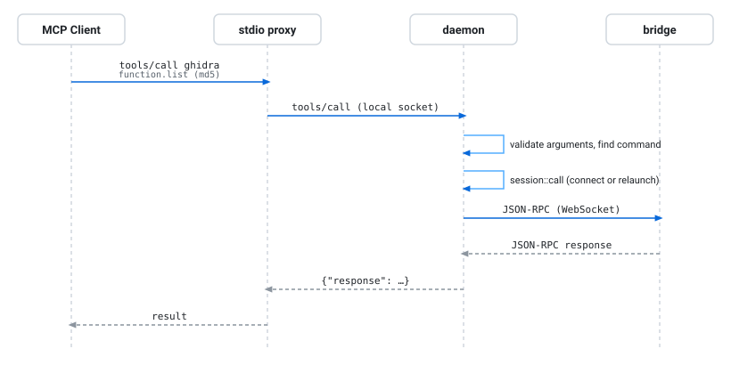

# Architecture

[English](architecture.md) | [中文](zh/architecture.md) | [日本語](ja/architecture.md)

This document describes the structure of `ghidra-mcp`.
It describes the processes, the request flows and the rules that keep the shared state correct.
It is for contributors.
[README.md](../README.md) describes the usage. [First Steps](getting-started.md) gives configuration steps.
[Troubleshooting](troubleshooting.md) covers common issues.
## Contents

- [Processes](#processes)
- [Source layout](#source-layout)
- [Request flows](#request-flows)
- [Session lifecycle](#session-lifecycle)
- [Concurrency](#concurrency)
- [Process ownership](#process-ownership)
- [Files on disk](#files-on-disk)
- [Interfaces](#interfaces)
- [Security model](#security-model)
- [Extend the system](#extend-the-system)

## Processes

One executable has all the roles:

| Role | Started by | State | Notes |
|---|---|---|---|
| **Daemon** (`--daemon`) | The first proxy or CLI call, or the user. | All the state. | One daemon runs for each runtime directory. A file lock enforces this rule. The daemon runs until you stop it. |
| **Stdio proxy** (no arguments) | An MCP client. | No state. | The proxy sends each tool call to the daemon. If necessary, it starts the daemon. |
| **CLI** (`tools`, `call`) | The user. | No state. | `tools` does not connect to the daemon. `call` makes one call through the daemon. |
| **Ghidra** (`analyzeHeadless`) | The daemon, one for each open session. | The analysis. | Ghidra runs the bridge as a post-script. |

Clients connect to the daemon through a **local socket**.
On Unix, the local socket is a Unix domain socket. On Windows, it is a named pipe.
The daemon writes the address of the socket in `server.json` in the runtime directory.
If no daemon answers, the client starts a daemon.

The client starts the new daemon as a detached process. Then the daemon continues to run after the client stops.

The **bridge** is a Java program in the `bridge/` submodule.
The command `cargo xtask build` builds the bridge with Gradle.
Then it embeds the bridge JAR and the launcher script `Bridge.java` in the executable.
Before each launch, the daemon writes the two files into the runtime directory.
It gives them to `analyzeHeadless -postScript`.
The bridge then connects to the daemon through a WebSocket and serves the analysis API.

## Source layout

All the Rust application code is in [`src/`](../src).
A module uses only the modules in the layers below it:

| Module | Responsibility |
|---|---|
| `cli` | The command-line arguments and the three run modes. |
| `daemon` | The listeners, the file lock, `server.json`, the detached start, proxy connection reuse and shutdown. |
| `mcp` | The MCP handler. It runs calls in the daemon, or sends them from the proxy to the daemon. |
| `mcp_http` | Streamable HTTP, legacy SSE sessions, CORS and HTTP compatibility. |
| `upload` | Upload credentials and the `POST /upload` endpoint. |
| `tools` | The MCP tools: the domain catalog, the local operations, the call validation and `ghidra_help`. |
| `session` | Open, launch, wait, relaunch, call and close for sessions. |
| `analysis` | Auto-analysis as a background job. |
| `project` | Saved binaries and the preparation of Ghidra projects. |
| `bridge` | The bridge contract, the embedded runtime, the WebSocket and single requests. |
| `jsonrpc` | The strict JSON-RPC 2.0 codec of the bridge WebSocket. |
| `state` | The shared state: one entry for each session, and the jobs. |
| `model` | The session, job and response records, and the session state machine. |
| `error` | Typed domain errors (`DomainError`) and JSON-RPC protocol error codes. |
| `config`, `paths` | `config.toml`, the persistent home and the runtime directory. |
| `process` | Child processes, log rotation (`RollingLogWriter`), token redaction, and full process tree stop. |
| `ghidra`, `java_path` | The search for `analyzeHeadless`, and the path conversion for Java. |

To read the API documentation of each module and item, use `cargo doc --document-private-items --open`.

## Request flows

### A tool call

The daemon shows `ghidra_help` and one MCP tool for each domain, for example `ghidra_function`.
The domains and the operations are the same as in the MCP server of the bridge.
A call has an `operation` and its `params`. An operation that names one session also has the `md5` of that session, never in `params`.
`ghidra_help` shows the md5 rule (`required`, `optional` or `absent`) and the effects of each operation.
This document writes an operation as the tool name and the operation name, for example `ghidra_session open`.

`tools::call` finds the domain and the operation in the catalog (`tools/catalog.rs`).
It validates `params` against the schema of the operation.
Then it does one of these:

- It runs a **local operation** from `LOCAL_OPERATIONS` (`tools/local.rs`): sessions, jobs, uploads and the start of an analysis.
- It sends a **bridge method** from the bridge contract `bridge/docs/asyncapi.yaml` to the bridge.

When a result has `structuredContent`, its `content` text block has the same JSON data.
This lets clients that read only `content` use the result.

When the bridge returns an error, the tool call fails. The failed result still contains the structured response.
The MCP handler maps errors to typed `DomainError` variants with JSON-RPC error codes (`-32602`, `-32001`, `-32002`, `-32000`, `-32603`).
The bridge distinguishes database transaction failures (HTTP 500 `transaction_failed`) from client argument errors (HTTP 400 `invalid_request`).

### Open a binary

`ghidra_session open` accepts a `path` on the daemon host, or the `md5` of a binary that the daemon saved before.
For a path, the daemon calculates the MD5 and copies the file into the persistent home.
Then later calls need only the MD5.
The daemon uses a connected session again, or joins a launch in progress, or starts a new launch.
[Session lifecycle](#session-lifecycle) describes the launch.

`ghidra_session open` returns the launch job immediately. If the client sets `wait`, it waits for the job.

### Upload a binary

The client can use a credential only one time.
The request uses the credential before the daemon reads the first byte.
The client must start the upload within ten minutes after `ghidra_upload prepare`.
The daemon does not stop an active upload.

### Shutdown

These events stop the daemon: Ctrl-C, `SIGTERM`, `SIGHUP`, and the equivalent Windows console events.
The daemon then does these steps:

1. It refuses new work.
2. It stops its listeners.
3. It stops all Ghidra processes, as [Process ownership](#process-ownership) describes.
4. It closes all bridge connections.
5. It gives its servers a short time to finish.

The sessions keep their runtime snapshots. After the next start, they are `stale`.

## Session lifecycle

The MD5 of the binary identifies a session.
A session has one of these statuses (`model::SessionStatus`):

Each transition is a `mark_*` method of `SessionRecord`.
For this reason, the rules for each transition are in one location.

A launch has four steps:

1. **`begin_launch`** prepares the project and stops the previous process.
   It saves a `launching` record with a new 256-bit bridge credential.
   It also makes the launch job. From this point, the job owns the session.
2. **`launch_process`** starts `analyzeHeadless` with the bridge as its post-script.
   It sets the session to `starting`.
3. The bridge connects and sends `ghidra.ready`.
   **`bridge::handshake`** examines the credential and attaches the connection.
   It sets the session to `ready`.
4. **`wait_ready`** sees `ready` and completes the launch job.
   The job fails if the process stops too early, the session fails, or the launch takes too long.

Each step first makes sure that its launch job or its credential still owns the session.
A newer launch can replace a launch, and a client can close a session.
In these conditions, the old step stops and does not change the newer state.

The next tool call for a session that is `disconnected` or `stale` relaunches the session.
The client does not see the relaunch.

## Concurrency

The daemon is a multi-threaded Tokio program.
Three mechanisms in `state.rs` keep the state correct:

- **The lifecycle lock** (`McpState::lifecycle_lock`, async) puts the session lifecycle transitions in sequence.
  The transitions are: open, launch, handshake, disconnect and close.
  A task can keep the lock across an await, for example while a process stops.
- **The state mutexes** protect the session map and the job map.
  A task keeps them only for short sections that do not block, and never across an await.
  For this reason, most state methods are synchronous.
- **The notifier** (`McpState::notify`) wakes all waiters after each change.
  Each waiter examines its condition again. For this reason, an unnecessary wake-up does no damage.
  The launch wait also examines the process each second, to find a process that stopped.

Each session has a maximum of one bridge request at a time.
A second request at the same time fails with `session already has a request in flight`.
Only the connection that sent a request can answer it. The daemon ignores an answer from a replaced bridge.
When a bridge disconnects, its open request gets a `BRIDGE_DISCONNECTED` error.

## Process ownership

`analyzeHeadless` is a script that starts a JVM.
For this reason, the daemon stops the full process tree, not one process (`process.rs`):

- **Unix.** The child process is the leader of a new process group.
  The daemon sends its stop signals to this group.
  If the daemon stops, the kernel closes its connections. This also occurs after `SIGKILL`.
  The bridge detects the closed connection.
  If it does not detect the close, a keepalive ping to the daemon fails.
  The bridge sends this ping every 5 seconds.

  Then it cancels an active analysis and saves the program.
  Ghidra exits.

  The daemon starts the bridge with `exit_deadline_sec=120`. If Ghidra does not exit in 2 minutes after the session ended, the bridge halts the JVM. It does not halt the JVM during a save.
  No other process watches the daemon.
- **Windows.** The daemon starts the child process in the suspended state.
  It puts the process in a job object.
  Then it resumes the process.
  The job object kills all its processes when its last handle closes. Only the daemon has this handle.

To stop a session, the daemon uses these steps:

1. It waits for the process to stop by itself. It waits only after a bridge disconnect or a normal close.
2. It tells the process tree to stop.
3. It kills the process tree.

`config.toml` sets the time limit of each step in `[timeouts]`.

`RollingLogWriter` manages child process logs:
- The daemon bounds active log files (`stdout.log`, `stderr.log`, `daemon.log`) to 10 MiB.
- The forwarder truncates oversized log lines. It replaces lines above 10 MiB with `[TRUNCATED_LOG_LINE]`.
- When a log reaches 10 MiB, the daemon rotates it and keeps up to 3 backup generations (`.1`, `.2`, `.3`).
- The forwarder redacts sensitive bearer authentication tokens on line boundaries with `[REDACTED_TOKEN]`.
- On Windows, the daemon closes active file handles before it renames a log file.
- The daemon rotates `daemon.log` before it opens that file if it is larger than 10 MiB.

## Files on disk

| Location | Contents | Lifetime |
|---|---|---|
| **Persistent home** (`GHIDRA_MCP_HOME`, default `~/.ghidra-mcp` or `%LOCALAPPDATA%\ghidra-mcp`) | `config.toml`, and `projects/<md5>/` with `binary`, `binary.json`, `binary.lock`, the Ghidra project in `ghidra/`, and retained crash recovery backups in `recovery-backups/`. | Kept. |
| **Runtime directory** (`ghidra-mcp-<uid>` in the runtime or temporary directory of the system, or `%LOCALAPPDATA%\ghidra-mcp\run`) | `daemon.lock`, `daemon.log`, `daemon.sock` (Unix), `server.json`, `sessions/<md5>/session.json`, `logs/<md5>/`, `tmp/`, the bridge files, and on Unix the `projects` link. | You can delete it. |

The publisher stages files beside their destination.
It synchronizes the files and renames them atomically.
Unix also synchronizes directory entries.
Windows requests write-through moves for published files.

An exclusive `binary.lock` covers verification and publication of the binary and its `binary.json` completion marker.
Readers take the same lock in shared mode and wait for publication.
Failed writes only remove their temporary files.
A new import attempt can complete a binary that has no metadata.

The daemon preserves an unrecognized nonempty Ghidra project and stops the open operation.
Saved projects use `OpenSavedProject.java` without `-process`.
Thus, the script controls the first program open and enables crash recovery.
If a recovery snapshot exists, the script first copies `.gpr` and `.rep` into a unique `recovery-backups/` directory.
The script synchronizes and publishes the copy before it opens the program.
A backup error stops the open operation.

The script saves recovered changes before the bridge starts.
Backups remain available after successful recovery.
The daemon does not use a backup that has a `.pending-` prefix.

Ghidra does not accept a project path with a hidden segment. But the default home is a hidden directory.
For this reason, on Unix the daemon gives Ghidra the **project launch alias** `<runtime>/projects`.
This alias is a symbolic link to the `projects/` directory in the persistent home.

## Interfaces

| Interface | Format | Contract |
|---|---|---|
| MCP tools `ghidra_*` | MCP through stdio, a local socket, Streamable HTTP or legacy SSE. | The operations in `LOCAL_OPERATIONS` and in the bridge contract. `ghidra_help` describes them. |
| Bridge WebSocket `/ws/agent` | Strict JSON-RPC 2.0 (`jsonrpc.rs`). | `bridge/docs/asyncapi.yaml`, from the bridge build. |
| Upload `POST /upload` | Raw bytes with a bearer credential. | The result of `ghidra_upload prepare`. |
| `server.json` | JSON with `pid`, `mcpUrl`, `bridgeWsUrl` and `localSocket`. | Local clients read it. |
| `config.toml` | TOML. | The README and `config.rs`. |
| Error Envelope | JSON inside MCP `structured_content`. | Standard JSON-RPC error codes (`-32602` to `-32603`) and machine-readable error variants. |

The MCP tool definitions, the operation schemas, the help output and the response shapes are public contracts.
Change them only in a deliberate change.
Record the change in the changelog.

## Security model

The daemon serves local users and the analysis tools that they run.
Do not make it available to other hosts.

- **Listeners.** The daemon accepts only loopback addresses.
  A request to `/mcp` or `/upload` must have the Host of the listener.
  `/mcp` accepts any valid HTTP or HTTPS Origin and returns CORS headers.
  `/upload` accepts only the Origin of the listener.
- **Local socket.** On Unix, the socket is in the private runtime directory.
  On Windows, it is a named pipe with a random name. Its access list lets only its owner connect, and it refuses remote clients.
- **Runtime directory.** At each start, the daemon makes sure that this directory is a real directory.
  The current user must own it, and its mode must be `0700`.
  For this reason, other users cannot read files in it or put files in it.
- **Bridge credentials.** A credential is a random 256-bit token.
  The daemon sends it only in an `Authorization` header, and never writes it to disk.
  The daemon removes it from the Ghidra logs.
  The credential is not valid after the session closes or the daemon restarts.
- **Upload credentials.** The client can use a credential only one time, for one MD5, one file name and one size.
  The daemon examines the bytes before it saves them.
  After the daemon refuses an upload, it reads and discards the other bytes of the body, to a maximum of 1 GiB and 30 seconds.
  For this reason, a client that sends all of the body before it reads the response also gets the error.
- **Messages to clients.** Error messages and summaries do not contain absolute paths or credentials.

[SECURITY.md](../SECURITY.md) tells you how to report a vulnerability.

## Extend the system

- **A local operation.** Add one entry to `LOCAL_OPERATIONS` in `src/tools/local.rs`.
  Give its domain, name, description, params schema, md5 rule, effects and handler.
  If it adds lifecycle behavior to a bridge method, set `extends` to the method.
  Use `parse` to read its parameters into a `Deserialize` struct.
  `ghidra_help`, the tool definitions and the validation then include the operation.
- **A bridge method.** Add the method to the bridge.
  Regenerate the contract after you add the method.
  The daemon reads the contract at compile time and shows the method in its domain tool.
  For a new domain, add the domain to `DOMAINS` in `src/tools/catalog.rs`.
  If the bridge MCP server puts the method in a different domain, add the same domain and operation names to `bridge_target`.
- **A session state or a transition.** Add a `mark_*` method to `SessionRecord` in `model.rs`.
  Call it while you have the lifecycle lock.
- **A long operation.** Make a job with `McpState::insert_job`.
  Do the work in a task.
  Complete the job with `McpState::finish_job`.
  Return the result of `McpState::await_job`.
  Then the caller can select whether to wait.
- **A configuration value.** Add a field to the applicable section in `config.rs`.
  Give it a default value and a doc comment.
  Document it in the README.
